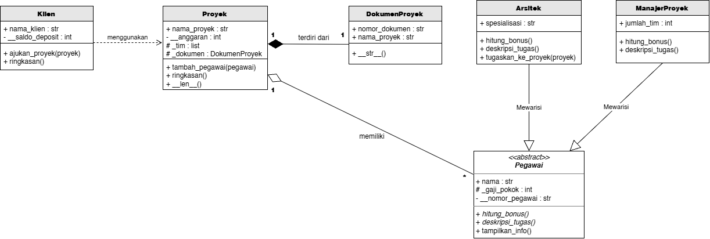
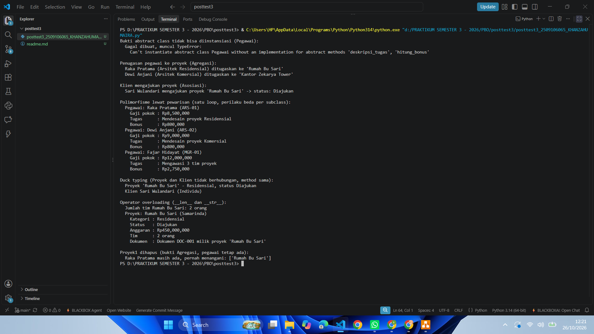

# Sistem Manajemen Proyek Arsitektur - CV Zekarya (Posttest 3)

Program OOP Python untuk mengelola proyek arsitektur di CV Zekarya: proyek, klien yang mengajukan, dan pegawai (arsitek dan manajer proyek) yang mengerjakannya. Posttest ini menambahkan Abstraksi dan Polimorfisme di atas Relasi UML dan Inheritance dari posttest sebelumnya.

## Class Diagram



**Asosiasi - `Klien` ke `Proyek`**
`Klien.ajukan_proyek(proyek)` cuma nerima objek `Proyek` lewat parameter dan gak nyimpennya sebagai atribut, jadi hubungannya sebatas "menggunakan" dan keduanya tetap berdiri sendiri.

**Agregasi - `Proyek` ke `Pegawai`**
`Arsitek` dan `ManajerProyek` dibuat di luar, baru didaftarkan ke `Proyek._tim` lewat `tambah_pegawai()`. Dipilih agregasi karena pegawai tetap ada walau proyeknya selesai atau dihapus, dan bisa dipindah ke proyek lain.

**Komposisi - `Proyek` ke `DokumenProyek`**
`DokumenProyek` dibuat langsung di dalam `Proyek.__init__()` dan gak pernah dibuat dari luar. Dipilih komposisi karena dokumen itu cuma punya arti buat proyeknya sendiri dan gak dipakai bareng proyek lain.

## Abstraksi

- `Pegawai` adalah abstract class (`ABC`) dengan 2 `@abstractmethod`: `hitung_bonus()` dan `deskripsi_tugas()`.
- `Arsitek` dan `ManajerProyek` sama-sama mengimplementasikan kedua method itu, dan manggil `super().__init__()`.
- Method konkret yang dipakai bersama: `Pegawai.tampilkan_info()`.
- `_gaji_pokok` (protected) bisa dipakai subclass, `__nomor_pegawai` (private) cuma milik `Pegawai`.
- Bukti abstract class gak bisa diinstansiasi: `Pegawai(...)` dibungkus `try-except TypeError`, hasilnya ada di screenshot di bawah.

## Polimorfisme

- **Lewat pewarisan:** `hitung_bonus()` dan `deskripsi_tugas()` di-override beda di `Arsitek` dan `ManajerProyek`, dipanggil lewat satu loop berisi kedua jenis objek (`tampilkan_info()` di main code).
- **Duck typing:** `Proyek` dan `Klien` gak berhubungan lewat pewarisan, tapi sama-sama punya `ringkasan()`. Keduanya dipanggil lewat satu fungsi `tampilkan_ringkasan()`.
- **Operator overloading:** `Proyek.__len__()` (jumlah anggota tim) dan `DokumenProyek.__str__()`.
- Gak ada `if/elif` yang ngecek `type()` atau string jenis, tiap objek nentuin perilakunya sendiri.

## Nilai Plus: SOLID

**Open/Closed Principle (OCP)** - loop pegawai dan fungsi `tampilkan_ringkasan()` gak perlu diubah kalau nanti ada subclass `Pegawai` baru (misalnya `Drafter`) atau kelas baru yang punya `ringkasan()`, tinggal ditambah kelasnya aja.

## Cara Menjalankan

```bash
python posttest3-2509106065-KhanzaHumaira.py
```

## Screenshot Output

